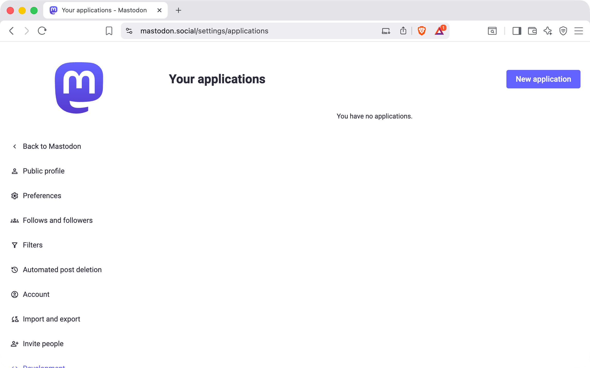
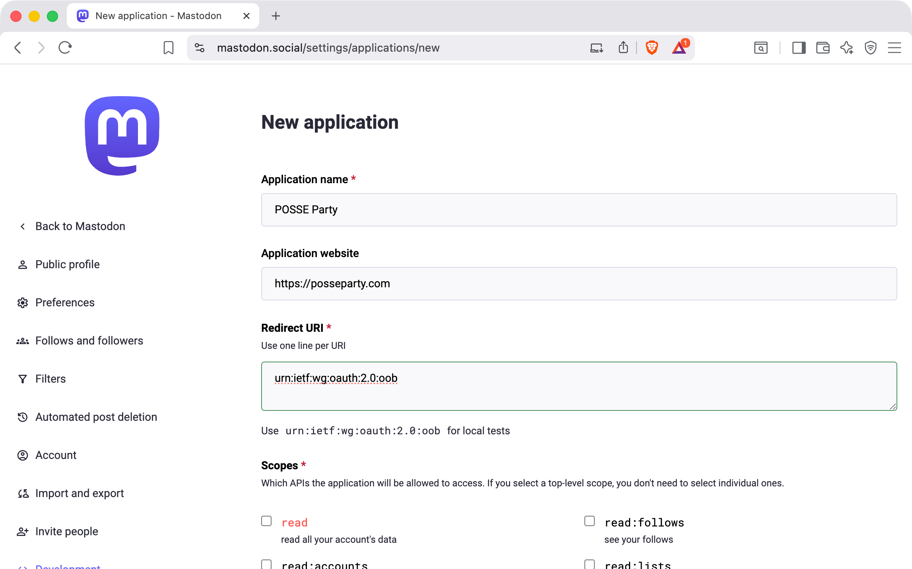
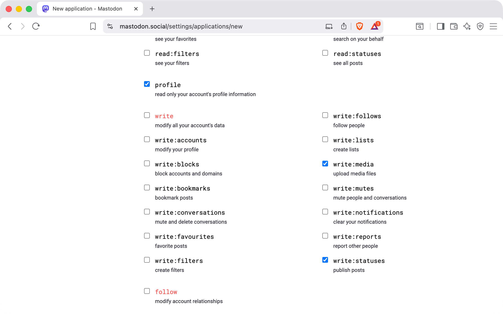
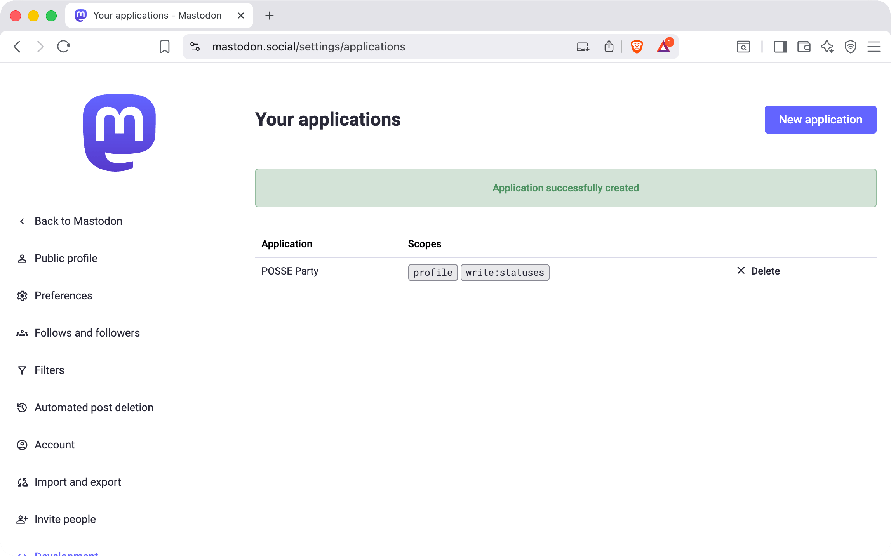
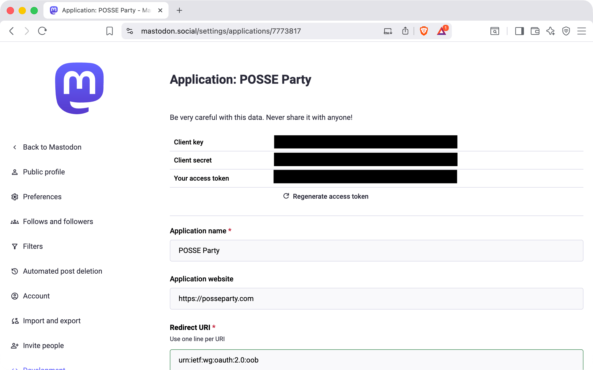
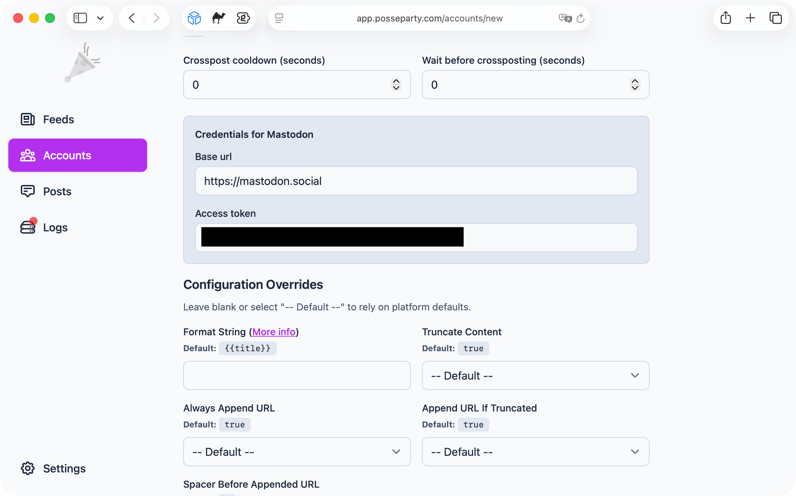

# Mastodon Account Setup

This guide walks through connecting your Mastodon account to POSSE Party so it can publish posts on your behalf.

## What POSSE Party Needs From You

- `Base URL` for your Mastodon instance, for example `https://mastodon.social`
- `Access Token` that authorizes POSSE Party to publish posts (`write:statuses`) and to attach photos and videos to them (`write:media`)

## How to Set Up Your Account

1. [Create a new application in Mastodon](#1-create-a-new-application-in-mastodon)
2. [Add Mastodon to POSSE Party](#2-add-mastodon-to-posse-party)

Already connected Mastodon before POSSE Party could attach media? See [Adding media to an existing account](#adding-media-to-an-existing-account).

### 1. Create a New Application in Mastodon

1. In your Mastodon account's settings, click `Development` from the sidebar to open your application settings. Then click **New application**.

2. Provide a name and the URL to your POSSE Party instance

3. Scroll to **Scopes**. Leave `profile` checked, and also check:
    - `write:statuses` to publish posts
    - `write:media` to attach photos and videos to them

   Then click **Submit**.

4. Once created, click the name of your application (it doesn't look like it, but it's a link)

5. Copy your **Access token** and take note of it

### 2. Add Mastodon to POSSE Party

1. In POSSE Party, go to **Accounts** and click **Add Account**. Give the account a label and select **Mastodon** as the platform.

2. Under **Credentials for Mastodon**, enter:
    - `Base URL` to your Mastodon instance URL (e.g., `https://mastodon.social`)
    - `Access token`

Once saved, POSSE Party will be able to publish crossposts to your Mastodon account using your site's feed and account settings.

## Adding media to an existing account

Earlier versions of this guide only asked for `write:statuses`. A token without `write:media` can still publish text, but any crosspost with photos or videos fails with a message that Mastodon wouldn't let the account upload media (HTTP 403, "This action is outside the authorized scopes"). To fix it:

1. In Mastodon, click `Development` in your settings and click the name of your POSSE Party application.
2. Under **Scopes**, check `write:media` (keep `profile` and `write:statuses` checked) and click **Save changes**.
3. Click **Regenerate access token** near the top of the page, then copy the new **Your access token**. The old token keeps its old scopes, so this step is required.
4. In POSSE Party, go to **Accounts**, click your Mastodon account to edit it, paste the new token into `Access token` under **Credentials for Mastodon**, and click **Save Account**.
5. Retry each crosspost that failed for this reason by opening it and clicking **Trigger publish**.
